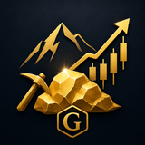
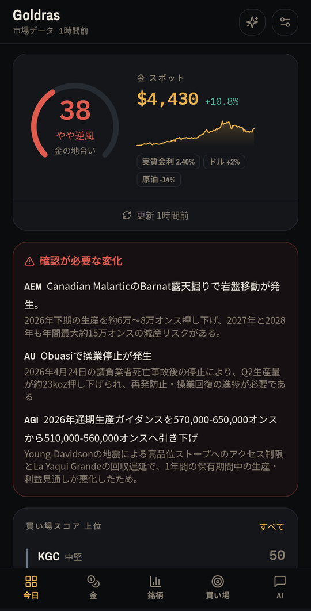
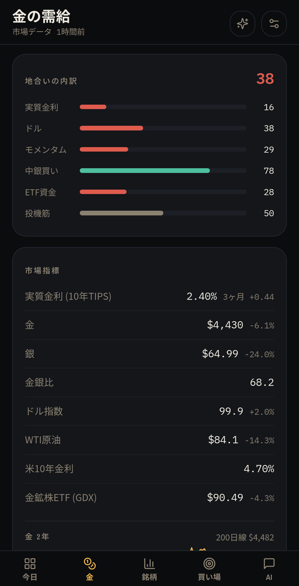
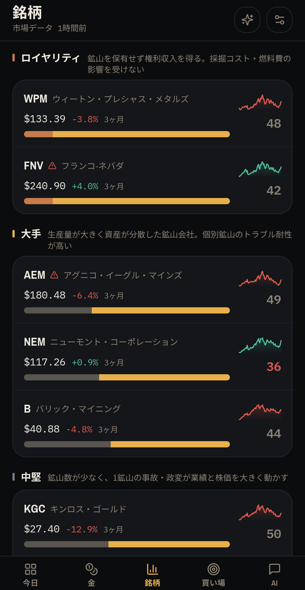
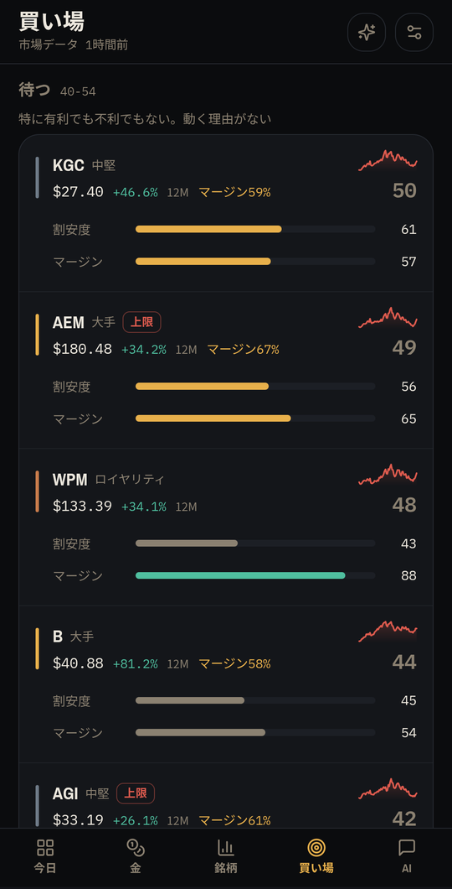
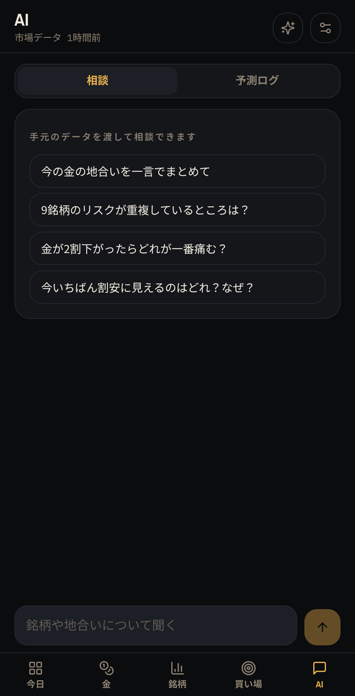
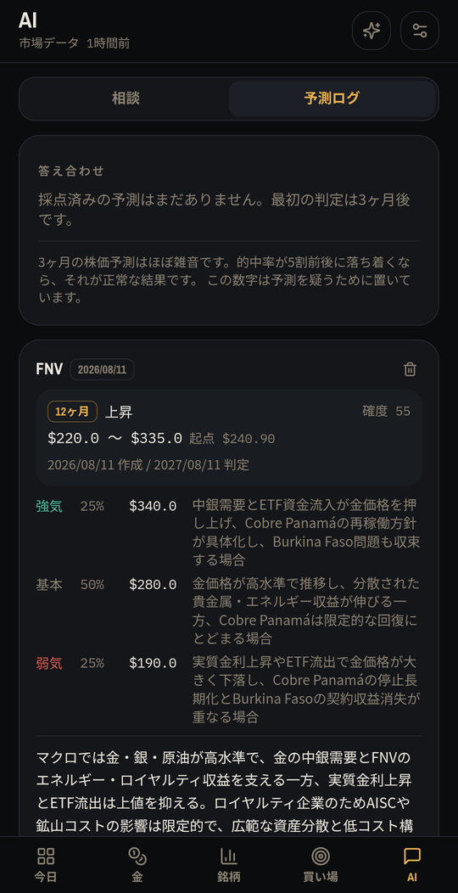

<p align="center">
  
</p>

<h1 align="center">Goldras</h1>

<p align="center">
  米国の金鉱株を、マクロとミクロの両面から追いかける Android アプリ<br>
  <sub>調査と予測は、あなた自身の ChatGPT サブスクリプション枠で端末内から実行されます</sub>
</p>

<p align="center">
  <a href="https://github.com/mokouliszt/Goldras/releases/latest"></a>
  
  <a href="LICENSE"></a>
</p>

---

1年程度の中長期保有を前提とした米国金鉱株投資補助を行います。  
(デフォルトの登録銘柄はブラックロック社48311032の構成銘柄)

価格・金利・原油のように機械的に取れるデータは端末が直接取得し、採掘コストや鉱山の操業状況のように数値化されていない情報は Codex が web 検索で拾ってきます。専用のサーバーも API キーも必要ありません。

<table>
  <tr>
    <td width="33%"></td>
    <td width="33%"></td>
    <td width="33%"></td>
  </tr>
  <tr>
    <td align="center"><sub><b>今日</b> — 地合いと確認が必要な変化</sub></td>
    <td align="center"><sub><b>金</b> — 需給とマクロ指標</sub></td>
    <td align="center"><sub><b>銘柄</b> — 業態別の一覧</sub></td>
  </tr>
  <tr>
    <td></td>
    <td></td>
    <td></td>
  </tr>
  <tr>
    <td align="center"><sub><b>買い場</b> — スコアによる並べ替え</sub></td>
    <td align="center"><sub><b>AI</b> — 手元のデータを渡して相談</sub></td>
    <td align="center"><sub><b>予測ログ</b> — 期限が来たら自動採点</sub></td>
  </tr>
</table>

## 同じ「金鉱株」として扱わない

初期状態で9銘柄を登録していますが、**業態が違うものを同じ物差しで測っても意味がありません**。3つに分けて、評価式そのものを切り替えています。

| 分類 | 銘柄 | 評価の軸 |
| --- | --- | --- |
| **ロイヤリティ** | WPM, FNV | 鉱山を持たず権利収入を得る。採掘コストと燃料費の影響を受けない |
| **大手** | NEM, B, AEM | 資産が分散し、個別鉱山のトラブル耐性が高い |
| **中堅** | KGC, AU, EGO, AGI | 鉱山数が少なく、1鉱山の事故や政変が業績に直結する |

たとえばロイヤリティ会社には採掘コスト（AISC）の欄自体を出しません。FNV は石油ガスのロイヤリティを持つため、**原油高を鉱山会社とは逆符号**で扱います。AI への指示文にも「ロイヤリティ会社に採掘コストの話を当てはめるな」と明示しています。

銘柄はアプリ内から追加・削除できます。定義の書式は [`app/src/main/assets/universe.json`](app/src/main/assets/universe.json) を参照してください。

## 画面

### 今日

金そのものの地合いスコアと、**確認が必要な変化**だけを積み上げます。毎日同じ画面を見せないことを優先しています。

危険信号は、1年の保有を揺るがすものだけに限っています。コストガイダンスの上方修正、鉱山の操業停止、産出国の税制変更、大規模な希薄化など。日々の値動きは材料にしません。

### 金の需給

1年保有ではここが最も効きます。

- **実質金利**（10年物 TIPS 利回り）— 教科書的な最重要指標
- **中央銀行の金購入** — 近年の主役。実質金利より説明力が高い局面が続いている
- **金 ETF 残高** — 西側投資家の資金流入
- **ドル指数**
- **COMEX 投機筋ポジション** — 極端な買い越しは逆張りの売り材料

### 銘柄

**コストバー**は、金1オンスの売値を1本の帯として、採掘コストが左から埋め、残りがそのまま利ざやになる図です。金が上がってもコストが同じだけ上がれば帯の見え方は変わらない、ということが数字を読まなくても分かります。マージンが22%を切ると赤に変わります。

ロイヤリティ会社は同じ図が成立しないため、意図的に別の描き方にしています。

### 買い場

4要素を合成した 0〜100 のスコアで並べ替えます。1年保有を前提とするため、**割安度とマージンで55%**を占める配分です。

| 要素 | 重み | 内容 |
| --- | --- | --- |
| 割安度 | 30% | P/NAV の過去比、52週レンジ内の位置、200日線乖離、GDX比の出遅れ |
| マージン | 25% | 金価格に対する採掘コストの余裕と、ガイダンス改定の方向 |
| マクロ | 25% | 実質金利・ドル・金モメンタム・原油（分類別に符号を反転） |
| 需給 | 20% | RSI、52週高値からの下落率 |

危険信号が検出されている間は、**どれだけ安く見えてもスコアに上限**がかかります（重大1件で54点、2件以上で42点）。「安いから買い」で地雷を踏まないための仕組みです。上限がかかった銘柄には `上限` バッジが付きます。

### AI

手元のデータを渡した上での自由な質問と、銘柄ごとのシナリオ予測、そして予測ログです。

**予測ログ**は、生成した予測を日付付きで保存し、期限が来たら現在値と突き合わせて自動採点します。方向が合っていたか、想定レンジに収まったかを記録します。

> 3ヶ月の株価予測はほぼ雑音です。的中率が5割前後に落ち着くなら、それが正常な結果です。**この数字は予測を疑うために置いています。**

この機能がないと、それらしい予測を検証せずに信じ続けることになります。

## AI をまとめて回す

銘柄を1つずつ開いてボタンを押して回るのは現実的ではないので、ヘッダーの ✨ から一括実行できます。

- **対象** — 古いものだけ / すべて
- **内容** — 基礎情報と金の需給（必須）／シナリオ予測も作る（任意）

実行前に必ず**処理件数を表示**します。ChatGPT の枠を使う操作なので、押した結果どれだけ消費するか分からないまま走らせない設計です。

実行中は前面サービスが立ち、通知に進捗バーと中止ボタンが出ます。**別のアプリを触っていても、画面を消していても最後まで走ります**（プロセスの凍結を防ぐ前面サービスと、スリープを防ぐ WakeLock を実行中だけ保持します）。中止しても、そこまでに取得できた分は保存されています。

設定から、起動時に自動で回すこともできます。既定はオフです。

## 通知

**重要イベント時のみ**通知します。2段構えで動きます。

まず6時間ごとに価格だけを見て、閾値を超える急変や、金が200日線をまたいだことを機械的に検出します。何かを掴んだ日だけ Codex にニュースの裏取りを走らせます。毎回 AI を呼ぶと ChatGPT の枠を無駄に消費するためです。

## データの出どころ

| 内容 | 取得元 | 方法 |
| --- | --- | --- |
| 株価・金・銀・原油・ドル指数・VIX・GDX・GLD | Yahoo Finance | 端末が直接取得 |
| 実質金利（10年物 TIPS） | FRED | 端末が直接取得 |
| AISC・生産量・ガイダンス・P/NAV | 各社 IR 資料 | Codex が web 検索 |
| 中銀購入・ETF フロー・COMEX 建玉 | 各種統計 | Codex が web 検索 |
| 鉱山の操業状況・地政学イベント | 業界メディア | Codex が web 検索 |

API キーが必要な有料データソースは使っていません。

## 動作環境

- Android 8.0 (API 26) 以上
- ChatGPT の有効なサブスクリプション（Codex が利用できるもの）

API キーには対応していません。初回にアプリ内から ChatGPT にログインすると、以降はそのサブスクリプション枠で調査と予測が実行されます。

**市場データの取得と表示だけならログイン不要**で動きます。

## インストール

[Releases](https://github.com/mokouliszt/Goldras/releases) から APK をダウンロードしてください。事前に「提供元不明のアプリ」のインストールを許可しておく必要があります。

### ソースからビルドする

```sh
git clone https://github.com/mokouliszt/Goldras.git
cd Goldras

# 1. Web UI をビルドして app/src/main/assets/webui へ出力する
cd webui && npm ci && npm run build && cd ..

# 2. APK をビルドする
./gradlew assembleRelease
```

Web UI のビルド成果物はリポジトリに含まれていません。**手順 1 を省略すると空の WebView が起動します。**

署名する場合は `keystore.properties.example` を `keystore.properties` にコピーして書き換えるか、環境変数 `GOLDRAS_KEYSTORE` / `GOLDRAS_STORE_PW` / `GOLDRAS_KEY_ALIAS` / `GOLDRAS_KEY_PW` を設定してください。いずれも指定がない場合は未署名でビルドされます。

## 構成

```
app/src/main/java/dev/mokouliszt/goldras/
  CodexAuth.kt       ChatGPT の OAuth（PKCE + localhost:1455 ループバック）
  CodexClient.kt     Codex backend を直接呼ぶ。web検索ON / shell を full-auto で実行
  Net.kt             システムDNS → Cloudflare DoH フォールバック
  MarketData.kt      Yahoo / FRED からの時系列取得と、RSI・移動平均・相対強弱の算出
  Scoring.kt         買い場スコアと金の地合いスコアの合成
  Store.kt           銘柄マスタ・スナップショット・基礎情報・予測ログの永続化
  Prompts.kt         銘柄調査 / マクロ調査 / シナリオ予測 / 対話 / 監視の指示文
  Alerts.kt          WorkManager による定期監視と、重要イベントの通知
  RequestService.kt  実行中だけ立てる前面サービス（進捗通知・WakeLock・中止）
  MainActivity.kt    全画面WebView、JSブリッジ、一括実行の制御

webui/src/
  App.tsx                  タブ構成、状態管理、設定
  components/Today.tsx     地合いと変化のダッシュボード
  components/Macro.tsx     金の需給
  components/Miners.tsx    銘柄一覧と詳細
  components/Signal.tsx    買い場スコアの並べ替えと内訳
  components/AiTab.tsx     対話・シナリオ予測・予測ログ
  components/BulkSheet.tsx AI処理の一括実行
  components/MarginBar.tsx コストバー
  components/Charts.tsx    スコアゲージ、スパークライン
  lib/native.ts            ネイティブブリッジと型
  lib/polyfills.ts         古い WebView 向けの補完
```

UI は React + Tailwind + shadcn/ui 由来のコンポーネントで構成し、Vite で `app/src/main/assets/webui` に出力します。WebView へは `WebViewAssetLoader` 経由で `https://appassets.androidplatform.net/` 配下から配信します。

Android 上で Codex を動作させる部分（PKCE ループバック認証、Responses API の直接呼び出し、web検索の常時有効化、shell ツールの full-auto サンドボックス実行）は、同作者の **[overlay-ai](https://github.com/mokouliszt/overlay-ai)** および **[Coupodex](https://github.com/mokouliszt/Coupodex)** の実装を流用しています。

## データの扱い

- 銘柄・市場データ・予測ログ・設定は端末内（`filesDir`）にのみ保存されます。外部への同期は行いません
- 端末外に送信されるのは、調査・予測のリクエストに含まれる銘柄名と手元の数値です。送信先はログイン済みの ChatGPT アカウントと、Yahoo Finance / FRED の各エンドポイントのみです
- アンインストールするとデータも削除されます。バックアップ機能はありません

## 制限事項

本アプリは公開されていない API を直接利用しています。ChatGPT の Codex backend (`chatgpt.com/backend-api/codex/responses`) に直接リクエストを送信するため、OpenAI 側の仕様変更により動作しなくなる場合があります。利用にあたっては OpenAI の利用規約を各自で確認してください。

Yahoo Finance のエンドポイントも同様に非公式であり、予告なく変更される可能性があります。

メーカー独自の省電力機能が前面サービスごと停止させることがあります。長時間の一括実行が途中で止まる場合は、設定→アプリ→Goldras→電池を「制限なし」にしてください。

## 免責

**本アプリは投資助言ではありません。**

スコアも予測も、過去のデータと公開情報から機械的・確率的に導いた参考値にすぎません。3ヶ月先や1年先の株価を当てられる道具ではなく、判断材料を集約して見落としを減らすためのものです。AI が取得した数値には誤りが含まれることがあります。重要な判断の前には必ず一次情報（各社の IR 資料）を確認してください。

投資判断は自己責任で行ってください。

## English

Goldras is an Android app for tracking US-listed gold mining equities over a one-year horizon.

It separates royalty/streaming companies from miners and scores each on valuation, margin, macro and flow, capping the score whenever a material red flag is detected. Price, rates and crude data are fetched directly by the device; unstructured data such as all-in sustaining costs, guidance revisions and jurisdiction events are gathered by Codex through your own ChatGPT subscription. No server and no API key are required. It also logs its own forecasts and grades them when they come due — because a forecast you never check is just noise you keep believing.

The UI is Japanese only. Requires Android 8.0+ and an active ChatGPT subscription; market data alone works without login. Not investment advice.

## ライセンス

[MIT](LICENSE) © 2026 mokouliszt
